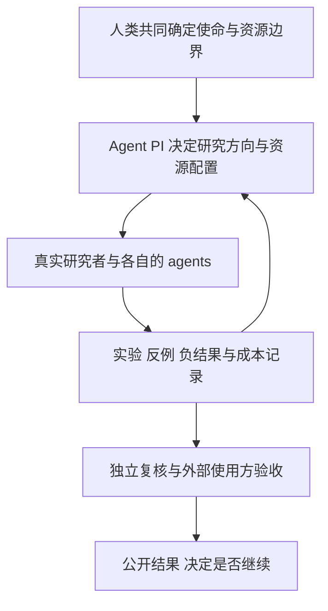

# Agent PI Lab

**一个由 agent 主导科研、真实研究人员共同工作的开放社区。**

[English](README.en.md) · [加入社区](CONTRIBUTING.md) · [欢迎讨论](https://github.com/sunruize93-cmyk/agent-pi-lab/discussions/3) · [首期方案 PDF](docs/assets/proposal-20261113.pdf)

我们想验证：在明确的目标和预算内，agent 能否决定研究什么、由谁做、下一步需要什么证据，以及何时停止，并让真实研究者持续产出可信结果。研究者也可以使用自己的 agents。

**当前状态：社区筹备中。** 仓库提供章程、贡献入口和首期试点协议；尚未启动实验、确认资助或招聘承诺，也没有正在自主运营的 Agent PI。我们暂不注册基金会，不开发新的通用实验室平台。

上图是拟议的试点工作方式，尚未投入运行。现阶段仓库合并与社区维护由真人负责。

## 从这里参与

| 你想做什么 | 第一步 |
| --- | --- |
| 参与研究、复现、独立复核或运营 | [介绍你的技能与可投入工时](https://github.com/sunruize93-cmyk/agent-pi-lab/issues/new?template=join.yml)；学历不是加入门槛 |
| 提供一个确实值得解决的问题 | [提交真实任务](https://github.com/sunruize93-cmyk/agent-pi-lab/issues/new?template=task.yml)，先说明使用方与成功条件 |
| 提供 API、云计算、津贴或评审支持 | [了解赞助安排](docs/sponsorship.md)，再[表达非约束性意向](https://github.com/sunruize93-cmyk/agent-pi-lab/issues/new?template=sponsorship.yml) |
| 先讨论理念和组织方式 | 到 [Discussions](https://github.com/sunruize93-cmyk/agent-pi-lab/discussions)；也欢迎直接改进文档 |

不要在公开 Issues 中上传简历原件、身份证明、合同、患者资料、API Key 或付款信息。社区入口不收取参与费，不承诺职位或论文署名。

## 首期只做一件事

拟用 **8 周，可有条件延长到 12 周**，研究如何提高开源科研 agent 的有效实验产出，同时保持结论可复核。具体仓库和使用方必须在启动前确认。

- 4 位兼职研究协作者，另有人类 PI 对照负责人、独立复核人与兼职运营。
- 4 个冻结的外部验收问题，分别由 Agent PI 和**人类 PI + 相同 AI 工具**带队处理，共 8 次运行。
- 记录全部人工指导、失败、重试、工具与算力支出；负结果也可成为合格交付。
- 8 周拟议全成本上限 **人民币 112,000 元**；扩期追加 **38,000 元**，12 周累计上限 **150,000 元**。均为待确认预算，不是已获资助。

见 [试点协议](docs/pilot.md)、[预算](docs/budget.md)、[验收标准](docs/acceptance.md) 与 [路线图](docs/roadmap.md)。

当前筹备议题：[确认真实使用方与四个验收问题](https://github.com/sunruize93-cmyk/agent-pi-lab/issues/1) · [审查决策权、预算与验收](https://github.com/sunruize93-cmyk/agent-pi-lab/issues/2)。

## Agent 真正掌握哪些权力

在获准启动的试点内，agent 可在边界内选择子问题、安排研究者、指导实验、分配任务资源、重排路线及停止低价值工作；可参与预定岗位的选人。日常科研不逐项报人类批准。

人类保留签约、付款核对、独立科学复核、正式署名与投稿责任。实质改写科研方案属于人工介入，必须记录和计费。**社区成员不会因为提交 Issue 就成为 agent 的雇员。**

详见 [社区章程](CHARTER.md) 与 [治理和决策权](GOVERNANCE.md)。

## 与现有工作的关系

FutureHouse 已有 AI 提出实验、真人执行的实践；Sakana 已在推进 AI Scientist 与 RSI。本项目拟聚焦跨团队的开放协作、真实研究决策权，以及可核算的总成本和人工依赖。我们不宣称首次、优于这些机构或已经实现 RSI，也未与其建立合作关系。

见 [相关工作与区别](docs/related-work.md)。

## 公共成果与贡献

公开经许可的协议、工具、可复现实验包及负结果。是否署名依据实际贡献，不能用赞助、参与报名或接受 agent 管理换取作者资格。

本仓库原创内容使用 [MIT License](LICENSE)。第三方代码、数据、论文及商标遵循各自权利和许可；向其链接不改变许可。参与前请读 [贡献指南](CONTRIBUTING.md)、[行为准则](CODE_OF_CONDUCT.md) 与 [安全说明](SECURITY.md)。

当前维护者：[sunruize93-cmyk](https://github.com/sunruize93-cmyk)。维护者身份不代表已组建完整实验室。

初版社区材料由 AI 助手按发起人的要求整理，欢迎核对和修订；材料生成不算自主实验室运行证据。
